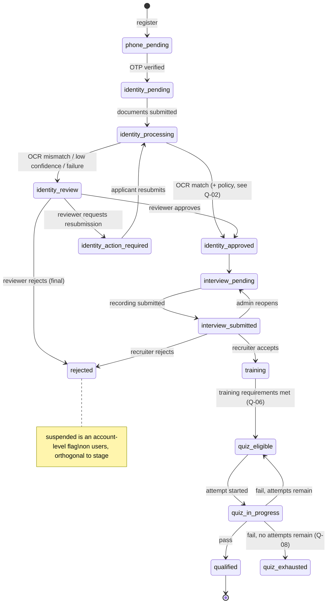

# 03 — User Journeys and Applicant State Machine

Status: **Draft v0.1**

## 1. Applicant lifecycle — state model

To avoid contradictory combinations, the lifecycle is stored as **one authoritative `application.stage`**, plus sub-records that hold the details (identity verification, interview submission, quiz attempts). Every transition is written to `application_stage_history` with the actor and the reason.

> Q-02: Should an OCR match auto-approve identity, or should **every** identity be human-reviewed? Proposed default: an OCR match with confidence ≥ threshold auto-approves, and a reviewer can still revoke it. This is pending client confirmation.
> Q-03: If the client prefers it, the interview could start as soon as documents are *submitted*, in parallel with review. The diagram above assumes identity must be *approved* first.

## 2. Transition table

| # | From → To | Actor | Preconditions | Side effects | Audit |
|---|---|---|---|---|---|
| T1 | — → phone_pending | Applicant | Unique email and phone | Create user + application; send OTP | user.registered |
| T2 | phone_pending → identity_pending | Applicant | Valid, unexpired OTP | `users.phone_verified_at` set | otp.verified |
| T3 | identity_pending / action_required → identity_processing | Applicant | 4 inputs present and valid; files in private storage | OCR job enqueued | identity.submitted |
| T4 | identity_processing → identity_approved / identity_review | System (OCR) | OCR finished or failed | OCR result stored | identity.ocr_completed |
| T5 | identity_review → approved / action_required / rejected | `identity.review` | Review is open | Notify applicant | identity.decided 🔒 |
| T6 | identity_approved → interview_pending | System | — | — | — |
| T7 | interview_pending → interview_submitted | Applicant | Upload verified in storage; no existing active submission | — | interview.submitted |
| T8 | interview_submitted → interview_pending | `applications.decide` | Reason required | Previous submission archived | interview.reopened 🔒 |
| T9 | interview_submitted → training / rejected | `interviews.review` + `applications.decide` | Reason required on reject | Notify applicant | application.decided 🔒 |
| T10 | training → quiz_eligible | System | Q-06 rule met | — | — |
| T11 | quiz_eligible → quiz_in_progress | Trainee | attempts_used < max; active quiz config | Attempt created with server deadline | quiz.attempt_started |
| T12 | quiz_in_progress → qualified / quiz_eligible / quiz_exhausted | System on submit or deadline | Attempt finalized exactly once | `qualified_at` set on pass | quiz.attempt_finalized |

Every transition runs inside a database transaction that locks the application row (`SELECT … FOR UPDATE`) and checks that the current stage still equals the expected `From`. A concurrent duplicate request therefore fails with `409 CONFLICT` instead of producing a double transition.

## 3. Applicant-facing journey (screens)

| Stage | Screen(s) | Mobile-first |
|---|---|---|
| 1 | Welcome/landing — brand, headline, Login, Sign up | ✅ |
| 2 | Registration form | ✅ |
| 3 | WhatsApp OTP entry, resend with cooldown | ✅ |
| 4 | ID number + front/back + selfie upload | ✅ |
| 5 | Identity status (submitted / processing / pending review / approved / action required) | ✅ |
| 6 | Interview instructions + reference video, then the recorder (permissions, record, preview, retry, submit) | ✅ |
| 7 | Interview submitted — pending review | ✅ |
| 8 | Decision — congratulations (→ training) or professional rejection | ✅ |
| 9 | Training dashboard — courses, videos, progress, quiz availability | ✅ |
| 10 | Quiz — instructions → timed attempt → result + remaining attempts | ✅ |
| 11 | Qualified — success screen → agent dashboard | ✅ |

The frontend routes the user to whichever screen matches `GET /api/v1/applications/me` → `stage`. A user who opens a URL for a different stage is redirected to the correct one. The backend independently rejects actions that are not valid for the current stage.

## 4. Staff journeys (summary)

- **Recruiter:** Applicants list → identity review queue → review workspace (documents, OCR fields, match indicator) → decision. Interview queue → playback → accept/reject with reason.
- **Training admin:** Courses → videos → question bank → quiz configuration → attempts/results.
- **Property manager:** Locations → compounds → types → unit models → media → prices.
- **Sales manager:** Leads → assign/reassign → assignment history → notes/activity.
- **Super admin:** Users → roles → audit logs → settings, plus all of the above.

## 5. Qualified agent journey

Dashboard (welcome, quick links, assigned-lead summary) → Properties (location → compound → unit model detail) → Leads (list → detail → add note / change status).
