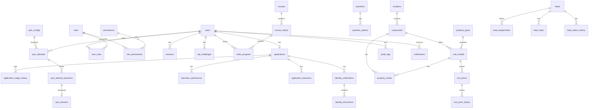

# 07 — Database Schema (logical model)

Status: **Draft v0.1** — proposed. Tables are created incrementally, one migration per feature slice. No table is created before its feature is being implemented.

## 1. Conventions

- Primary keys are `UUID` (v4, generated in the app). They are non-enumerable, which supports the IDOR defense.
- Every table has `created_at timestamptz not null default now()`. Mutable tables also have `updated_at`.
- All timestamps are `timestamptz` in UTC. The UI renders `Africa/Cairo`.
- Status fields are `varchar` + `CHECK` constraints, not native PG enums. They are easier to migrate.
- Money: `NUMERIC(14,2)` + `currency char(3)` (ISO 4217, `CHECK (currency ~ '^[A-Z]{3}$')`).
- Soft deletion (`archived_at`) for catalogue, training, and lead records. Hard delete only for ephemeral data (sessions, OTP challenges). Audit, decision, and assignment history are **never** deleted by the application.
- Foreign keys default to `ON DELETE RESTRICT`. `CASCADE` only for pure child rows (for example, quiz_answers → quiz_attempts).
- Every FK column is indexed.

## 2. ERD

## 3. Tables (summary)

### Identity and access
| Table | Key columns | Constraints / notes |
|---|---|---|
| `users` | id, email, phone_e164, password_hash, first_name, last_name, phone_verified_at, is_active, last_login_at | unique(email), unique(phone_e164) |
| `roles` | id, key, name | unique(key). Seeded: super_admin, recruiter, training_admin, sales_manager, property_manager |
| `permissions` | id, key, description | unique(key). Seeded from `02-…` §3 |
| `role_permissions` | role_id, permission_id | PK(role_id, permission_id) |
| `user_roles` | user_id, role_id, granted_by, granted_at | PK(user_id, role_id) |
| `sessions` | id, user_id, token_hash, csrf_hash, expires_at, last_seen_at, revoked_at, ip, user_agent | unique(token_hash); idx(user_id) |
| `otp_challenges` | id, user_id, phone_e164, code_hash, expires_at, attempts, consumed_at, locked_at | idx(phone_e164, created_at) |
| `otp_events` | id, user_id, phone_e164, event (sent/failed/verified/locked/provider_error), ip | never stores the code |

> The brief's `agent_profiles` is folded into `users` + `applications` until there are agent-only attributes (bio, areas served). This avoids an empty 1:1 table. It can be revisited later.

### Recruitment
| Table | Key columns | Notes |
|---|---|---|
| `applications` | id, user_id (unique), stage, qualified_at, rejected_at, version | One per user. `stage` CHECK against the state list in `03-…` |
| `application_stage_history` | id, application_id, from_stage, to_stage, actor_id (null=system), reason, created_at | append-only |
| `identity_verifications` | id, application_id, national_id_enc, national_id_last4, ocr_status, ocr_extracted_enc, ocr_confidence, match_result, review_status, reviewer_id, reviewed_at, decision_reason | national ID is encrypted at the application level (see `09-…`) |
| `identity_documents` | id, verification_id, kind (front/back/selfie), storage_key, content_type, size_bytes, sha256 | unique(verification_id, kind) |
| `interview_submissions` | id, application_id, storage_key, duration_s, content_type, size_bytes, status (active/archived), submitted_at, idempotency_key | partial unique(application_id) WHERE status='active' |
| `application_decisions` | id, application_id, kind (identity/interview), decision, reason_public, notes_internal, decided_by, decided_at | append-only |

### Training and quiz
| Table | Key columns | Notes |
|---|---|---|
| `courses` | id, title, description, position, status (draft/published), archived_at | |
| `course_videos` | id, course_id, title, duration_s, position, storage_key / external_url, status | |
| `video_progress` | user_id, video_id, watched_s, completed_at, updated_at | PK(user_id, video_id) |
| `questions` | id, text, is_active, archived_at | |
| `question_options` | id, question_id, text, is_correct, position | exactly one correct, enforced in service + deferred check |
| `quiz_configs` | id, question_count, pass_threshold_pct, max_attempts, time_limit_min, is_current, created_by | append-only versions; partial unique(is_current) WHERE is_current |
| `quiz_attempts` | id, user_id, config_id, attempt_no, started_at, deadline_at, submitted_at, finalized_reason (submitted/expired), score_correct, score_pct, passed | unique(user_id, attempt_no) — a hard backstop for the attempt limit |
| `quiz_attempt_questions` | id, attempt_id, question_id, position | snapshot of the drawn questions |
| `quiz_answers` | attempt_question_id (PK), option_id, answered_at | upsert = idempotent |

### Properties
| Table | Key columns | Notes |
|---|---|---|
| `locations` | id, name, slug, is_active | unique(slug) |
| `compounds` | id, location_id, name, slug, description, address, lat, lng, developer_name, amenities (jsonb array), status | unique(location_id, slug) |
| `property_types` | id, key, name, is_active | unique(key) |
| `unit_models` | id, compound_id, property_type_id, name, area_sqm NUMERIC(8,2), bedrooms, bathrooms, floor_info, finishing, view, availability, extra_specs jsonb, status | unique(compound_id, name) |
| `property_media` | id, compound_id?, unit_model_id?, kind (image/floor_plan/video), storage_key, position, caption | CHECK exactly one parent |
| `unit_prices` | id, unit_model_id, label (e.g. "Cash", "Installments base"), amount NUMERIC(14,2), currency char(3), updated_by, updated_at | unique(unit_model_id, label, currency) |
| `unit_price_history` | id, price_id, amount, currency, changed_by, changed_at | append-only |

### Leads
| Table | Key columns | Notes |
|---|---|---|
| `leads` | id, full_name, phone_e164, email, interest (text), location_id?, source, status, current_assignee_id?, last_activity_at, archived_at | idx(current_assignee_id, last_activity_at) |
| `lead_assignments` | id, lead_id, from_agent_id?, to_agent_id, assigned_by, assigned_at, reason | append-only |
| `lead_notes` | id, lead_id, author_id, body, created_at | append-only |
| `lead_status_history` | id, lead_id, from_status, to_status, changed_by, changed_at | append-only |

`leads.current_assignee_id` is a deliberate denormalization of "latest assignment". It is updated in the same transaction as `lead_assignments`. This gives a cheap, indexable ownership check for LEAD-007.

### Platform
| Table | Key columns | Notes |
|---|---|---|
| `audit_logs` | id, actor_id?, action, entity_type, entity_id, before jsonb, after jsonb (redacted), ip, request_id, created_at | append-only; idx(entity_type, entity_id), idx(actor_id, created_at) |
| `notifications` | id, user_id, kind, title, body, read_at | |
| `system_settings` | key (PK), value jsonb, updated_by, updated_at | typed and validated by a Pydantic registry |

## 4. Trade-offs recorded

1. **Single `stage` column vs. multiple booleans.** One stage plus history makes impossible combinations unrepresentable and transitions auditable. The cost is that all transitions must go through one service.
2. **Quiz config versioning.** Attempts reference the config row they started with, so admin changes never change in-flight or past results (BR-2.4).
3. **Application-level encryption of the national ID number.** This protects against DB dump leakage at the cost of not being able to query by full number. Lookup for duplicate detection uses a keyed HMAC (`national_id_hmac`, unique) — to be added with FEAT-003.
